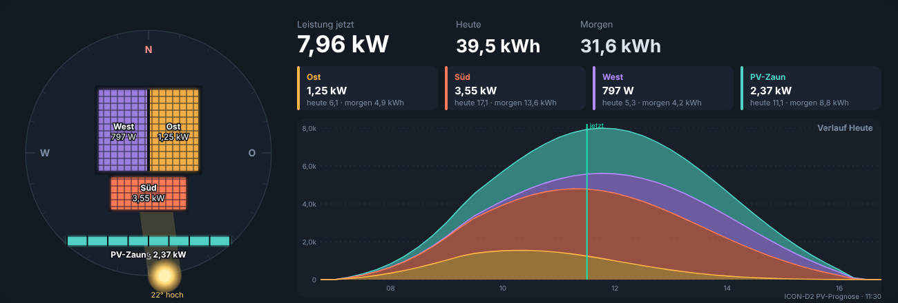

# ICON-D2 PV-Prognose für Home Assistant

Custom Integration, die die Erzeugung einer PV-Anlage **ausschließlich auf Basis des DWD-Modells ICON-D2** vorhersagt (~2 km Raster, 15-Minuten-Werte, ~48 h). Die Strahlungsdaten kommen kostenlos und ohne API-Key von [Open-Meteo](https://open-meteo.com).

- **Mehrere Strings** mit eigener Leistung, Neigung und Ausrichtung
- **Teilverschattung** über ein Horizontprofil pro String (Bäume, Gebäude, Berge)
- **Feinjustierung** manuell pro String und für die ganze Anlage
- **Automatische Kalibrierung** gegen die echte Erzeugung deines Wechselrichters
- Wechselrichter-Limit, Temperaturverluste, Systemverluste
- Prognose im **Energie-Dashboard** von Home Assistant
- Einrichtung komplett über die Oberfläche

## Warum nur ICON-D2?

ICON-D2 ist ein kurzfristiges Regionalmodell mit feinem Raster und wird alle 3 Stunden neu gerechnet. Es bildet Hochnebel, Inversionen und lokale Bewölkung deutlich besser ab als globale Modelle. Die Prognose reicht dafür nur bis morgen – für die Steuerung von Speicher, Wallbox oder Verbrauchern ist das genau der relevante Zeitraum.

---

## Installation

### Über HACS (empfohlen)

1. HACS → ⋮ → **Benutzerdefinierte Repositories**
2. URL `https://github.com/stefanharm/PV_Forecast` eintragen, Typ **Integration**
3. „ICON-D2 PV-Prognose“ herunterladen
4. Home Assistant **neu starten**

> Ist das Repository privat, braucht HACS Zugriff darauf – sonst manuell installieren.

### Manuell

1. Den Ordner `custom_components/icond2_pv` nach `/config/custom_components/icond2_pv` kopieren
2. Home Assistant **neu starten**

### Einrichten

Einstellungen → Geräte & Dienste → **Integration hinzufügen** → „ICON-D2 PV-Prognose“

1. **Standort und Anlage**: Name, Koordinaten (vorausgefüllt aus der Home-Zone), Systemverluste, Wechselrichter-Limit
2. **Ersten String** anlegen
3. Weitere Strings hinzufügen oder **Fertig**

Alles lässt sich später über **Konfigurieren** ändern: Strings hinzufügen, bearbeiten, entfernen sowie Feinjustierung und Kalibrierung.

---

## Parameter

### Anlage

| Parameter | Bedeutung | Standard |
|---|---|---|
| Systemverluste | Kabel, Wechselrichter, Verschmutzung, Mismatch | 14 % |
| Wechselrichter-Limit | maximale AC-Leistung, auf die die Prognose begrenzt wird (0 = kein Limit) | 0 kW |
| Gesamt-Faktor | manuelle Feinjustierung der ganzen Anlage | 100 % |
| Automatische Kalibrierung | lernt einen Korrekturfaktor aus der Ist-Erzeugung | aus |
| Ist-Erzeugung | Energie-Sensor der PV-Erzeugung (kWh/Wh, mit Langzeitstatistik) | – |
| Lernzeitraum | Anzahl der letzten Tage für den Kalibrierfaktor | 14 Tage |

### String

| Parameter | Bedeutung | Standard |
|---|---|---|
| Leistung | DC-Nennleistung des Strings | – |
| Neigung | 0° = waagrecht, 90° = senkrecht (PV-Zaun, Fassade) | 30° |
| Ausrichtung | 0° = Nord, 90° = Ost, 180° = Süd, 270° = West | 180° |
| Horizontprofil | Verschattung, siehe unten | frei |
| Wirkungsgrad-Faktor | Feinjustierung nur dieses Strings | 100 % |
| Dämpfung morgens / abends | reduziert die Prognose bei tiefer Sonne (voll am Horizont, keine Wirkung ab 30° Sonnenhöhe) | 0 % |
| Temperaturkoeffizient | aus dem Moduldatenblatt | −0,35 %/K |
| Albedo | Bodenreflexion: Wiese 0,2, Schnee bis 0,8 | 0,2 |

### Horizontprofil (Teilverschattung)

Pro String eine Liste aus **Himmelsrichtung:Höhenwinkel** in Grad. Zwischen den Punkten wird linear interpoliert, umlaufend über Norden.

```
90:5, 135:25, 160:25, 180:8, 250:15
```

Bedeutung: Im Osten ist der Horizont 5° hoch, von Südost bis Süd-Südost verdeckt z. B. ein Baum bis 25°, im Süden 8°, im Westen 15°.

- Steht die Sonne **unter** dieser Linie, fällt die Direktstrahlung für den String weg.
- Das diffuse Himmelslicht wird entsprechend dem verdeckten Himmelsanteil reduziert.
- Leer lassen = freier Horizont.

**Höhenwinkel ermitteln:** mit einer Neigungsmesser-App vom Modulstandort aus auf die Oberkante des Hindernisses peilen, die Richtung mit dem Kompass. Alternativ liefert [PVGIS](https://re.jrc.ec.europa.eu/pvg_tools/de/) unter „Horizont“ ein Geländeprofil.

---

## Feinjustierung

### Manuell

1. Zuerst einige klare Tage abwarten und **Energie heute** mit der echten Erzeugung vergleichen.
2. Weicht die ganze Anlage gleichmäßig ab → **Gesamt-Faktor** anpassen.
3. Weicht nur ein String ab (getrennte MPP-Tracker sind im Wechselrichter meist einzeln sichtbar) → **Wirkungsgrad-Faktor** dieses Strings anpassen.
4. Stimmt der Tag, aber morgens oder abends liegt die Prognose zu hoch → **Dämpfung morgens/abends** erhöhen oder das **Horizontprofil** genauer erfassen.

### Automatische Kalibrierung

Jeden Tag nach Mitternacht wird die Prognose des Vortags mit der tatsächlichen Erzeugung verglichen. Aus dem **Median** der Verhältnisse der letzten Tage entsteht der **Kalibrierfaktor**, der auf die ganze Anlage wirkt.

- Sensor: die PV-**Erzeugung** in kWh oder Wh mit Langzeitstatistik (`state_class: total_increasing`), z. B. „Energie gesamt“ des Fronius-Wechselrichters. **Nicht** die Einspeisung.
- Sehr trübe Tage (unter 0,3 kWh je kWp Prognose) werden ignoriert.
- Einzelne Ausreißer sind auf 50–150 % begrenzt; durch den Median fallen Tage mit Abregelung oder Ausfall kaum ins Gewicht.
- Der aktuelle Faktor und die gelernten Tageswerte stehen im Sensor **Kalibrierfaktor**.
- Zurücksetzen: Aktion `icond2_pv.reset_calibration`.

Manuelle Faktoren und Kalibrierung wirken zusammen. Sinnvoll: Strings manuell grob einstellen, die Kalibrierung gleicht den Rest aus.

---

## Entitäten

Pro Anlage (Präfix = Name der Anlage, z. B. `sensor.pv_prognose_…`):

| Sensor | Inhalt |
|---|---|
| Leistung jetzt | erwartete AC-Leistung im aktuellen 15-Minuten-Intervall (W) |
| Energie heute | Tagesprognose (kWh), Attribut `forecast` mit allen 15-Minuten-Werten |
| Energie heute verbleibend | ab jetzt bis Mitternacht (kWh) |
| Energie morgen | Tagesprognose morgen (kWh), Attribut `forecast` |
| Energie nächste Stunde | kWh in den nächsten 60 Minuten |
| Spitzenleistung heute / morgen | höchste Leistung (W), Attribut `time` |
| Kalibrierfaktor | gelernter Faktor (%), Attribute mit den Tageswerten |

Pro String: **Leistung jetzt**, **Energie heute**, **Energie morgen** (jeweils mit `forecast`-Attribut).

### Energie-Dashboard

In den **Energie-Einstellungen** bei der Solarproduktion die Prognose aktivieren und „ICON-D2 PV-Prognose“ auswählen.

---

## Visualisierung (optional)

`www/pv_anlage.html` zeigt die Anlage als Draufsicht mit Sonnenstand, die Strings eingefärbt nach aktueller Leistung, dazu Kacheln pro String und den gestapelten Tagesverlauf. Nach Sonnenuntergang wechselt das Diagramm auf die Prognose für morgen.



1. `www/pv_anlage.html` nach `/config/www/pv_anlage.html` kopieren
2. Inhalt von `www/pv_anlage_karte.yaml` als manuelle Karte einfügen und die Entity-IDs anpassen

| Parameter | String |
|---|---|
| `ost`, `sued`, `west`, `zaun` | Entity-ID des Sensors **Energie heute** des jeweiligen Strings |
| `gesamt` | Entity-ID von **Energie heute** der Anlage (optional) |
| `v` | Versionsnummer, bei Änderungen erhöhen (Browser-Cache) |

Nicht angegebene Strings werden ausgelassen. Die Seite liest die Werte direkt aus der laufenden Home-Assistant-Oberfläche und funktioniert deshalb nur als Webseiten-Karte unter `/local/`. Zum Ausprobieren ohne Home Assistant: `pv_anlage.html?demo=1`.

---

## Wie wird gerechnet?

Für jedes 15-Minuten-Intervall und jeden String:

1. **Sonnenstand** (NOAA-Algorithmus)
2. **Einstrahlung auf die Modulebene** aus Direkt-, Diffus- und Globalstrahlung von ICON-D2 (Hay-Davies-Modell inkl. Bodenreflexion)
3. **Horizontverschattung** von Direkt- und Diffusanteil
4. **Zelltemperatur** (Faiman-Modell aus Lufttemperatur, Wind und Einstrahlung) → Temperaturverlust
5. Feinjustierung, Dämpfung, Kalibrierung, Systemverluste
6. Summe aller Strings, begrenzt auf das **Wechselrichter-Limit**

Das Rechenmodell wurde gegen die Referenzbibliothek [pvlib](https://pvlib-python.readthedocs.io) geprüft (Sonnenstand < 0,01°, Einstrahlung auf die Modulebene < 0,5 % Abweichung).

---

## Datenquelle & Lizenz

- Wetterdaten: Deutscher Wetterdienst (DWD), ICON-D2, bereitgestellt über [Open-Meteo](https://open-meteo.com) unter **CC BY 4.0**. Open-Meteo ist für nicht-kommerzielle Nutzung kostenlos.
- Code: MIT-Lizenz.
